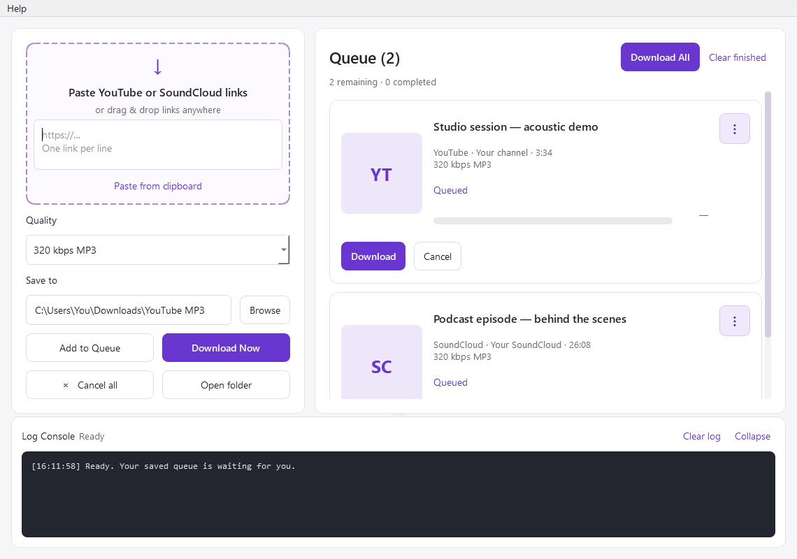

# YouTube & SoundCloud to MP3

A small local Windows app. Everything downloads and converts on your computer.

**Windows 10/11, 64-bit.** Download the `.exe` using the button above, then double-click it. You do **not** need GitHub's “Source code” ZIP, Python, or any setup scripts. No administrator access is needed. Allow a few seconds for the app to open.

## Portable Windows executable

Download **YT-SC Downloader.exe** from the [latest release](https://github.com/crunchygeoduck/mp3downloader/releases/latest), then double-click it. This single-file Windows x64 build includes Python, Qt, yt-dlp, FFmpeg/ffprobe, and Node.js. No installation or administrator access is required. Startup can take a little longer while bundled tools are extracted to a temporary folder. Downloads are saved to your selected folder, and folder/quality preferences are remembered.

The executable is unsigned, so Windows may show an unknown-publisher or SmartScreen warning. Verify you downloaded it from this repository's Releases page. If your PC or organisation blocks it, do not disable its security software; ask the administrator for help.

The app checks GitHub for new stable releases at startup and shows a download banner when an update is available. Use **Help → Check for updates** at any time, or disable automatic checks in **Help → About / Getting started**. Updates are downloaded manually: close the app and replace the old `.exe` with the new one. Your saved queue and preferences remain on the PC.

See [BUILDING.md](BUILDING.md) to build the executable or run the packaging check. Source code and tests live in this repository; large executable downloads are attached to Releases.

## Use

1. Open **YT-SC Downloader.exe**, or use **Start.cmd** after setting up the source version.
2. Paste individual YouTube video or SoundCloud track links, one per line. You can mix both services in the same batch.
3. Choose MP3 quality and a folder, or keep `Downloads\YouTube MP3`.
4. Click **Add to Queue** to save the links for later, or **Download Now** to download the entered links. Use **Download All** above the queue to start all currently queued items.
5. Click **Open folder** to find your files.

Public and unlisted YouTube videos and publicly accessible SoundCloud tracks are supported. For SoundCloud, use the full track URL (`https://soundcloud.com/artist/track`); open shortened share links in your browser and copy the full track URL first. Links with share query parameters are accepted. Tracks requiring sign-in or a subscription are not supported; some tracks may only offer a preview.

Profile and playlist links are rejected; a YouTube video URL containing a playlist downloads only that video. Cancel stops the download/conversion; temporary partial files may remain and can be resumed on retry. Existing MP3 files are not overwritten. MP3 conversion cannot improve the original audio quality.

## Queue controls

- Paste from clipboard or drag links into the window, then add them to the queue. Adding links never starts them automatically. Each item retains its chosen folder and quality.
- Adding a link fetches its title, artwork, uploader, and duration in the background without downloading audio. Preview lookups run one at a time; if a lookup fails, the card stays queued and can still be downloaded.
- **Download Now** starts only the entered links. Each card has **Download** and **Cancel** buttons; failed or cancelled cards offer **Retry**. If another download is running, requested tracks wait their turn.
- **Download All** starts the current queued items sequentially. Links added afterward stay queued until you choose to download them.
- Choose 128, 192, 256, or 320 kbps MP3, or best quality (variable bitrate). Folder and quality are remembered between launches.
- Track cards show title, uploader, duration, artwork when available, and download progress. Conversion uses an activity indicator because yt-dlp does not expose reliable conversion percentages.
- Click artwork to open the source, or play the downloaded MP3 in your default audio player when complete.
- Use Cancel on a card to cancel that track, or Cancel all to stop active and queued tracks. Closing the app cancels remaining work.
- After cancellation finishes, **Remove from Queue** appears beside Cancel. It removes the card without deleting files; Retry remains available if you change your mind.
- The ⋮ menu offers the source link, download folder, copy link, retry for failed/cancelled tracks, and removal from the queue. Clear finished removes cards, not files.
- Clear or collapse the log console; drag the divider above it to resize it.
- Unfinished tracks are saved locally and restored when you reopen the app. Interrupted downloads return to Queued and wait for you to start them; cancelled/failed tracks retain Retry. Completed cards are not restored. Partial downloads can resume when the source supports it.
- Failed cards explain common problems such as sign-in requirements, internet issues, rate limits, disk space, or folder permissions. Use Retry, or **⋮ → Change save folder** before retrying a folder error. The log retains the technical details.
- Existing MP3s are preserved; to download a different quality, choose a different folder or remove the old file first.

## Help, privacy, and reporting problems

**Help → About / Getting started** shows the app version and usage guide. **Help → Report a problem** opens GitHub Issues. Include your app version, Windows version, what you expected, and relevant log lines. Check logs for private links or personal paths before sharing them.

Saved queue data is stored in `%LOCALAPPDATA%\YTSCDownloader\queue.json` on Windows. It includes queued links, output folders, and preview metadata. Removing a card removes it from the saved queue; it does not delete downloaded files. Only one app instance can run at a time to avoid overwriting the saved queue.

Automatic update checks send a request to GitHub for the latest release; they do not send your queue or video links. Metadata/artwork and downloads contact YouTube, SoundCloud, and their media hosts as needed. No browser cookies or account credentials are read by this app.

## Setup and updates

For the source version, run **Setup.cmd** to install or update the downloader. It installs dependencies in this project's `.venv` directory.

For another Windows computer, install Python 3.10+, FFmpeg (with ffprobe), and Node.js 22+ on PATH, then run Setup.cmd. Setup installs the Qt interface (PySide6 Essentials) and downloader. No browser cookies or account credentials are read by this app.

Run the regression tests with `.venv\Scripts\python.exe -m unittest discover -v`.

Only download audio you own or have permission to download. Third-party components retain their own licenses; see [THIRD_PARTY_NOTICES.md](THIRD_PARTY_NOTICES.md).
